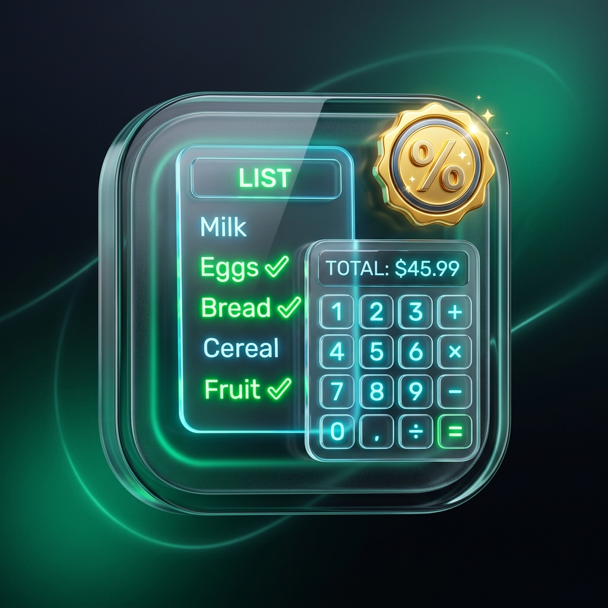
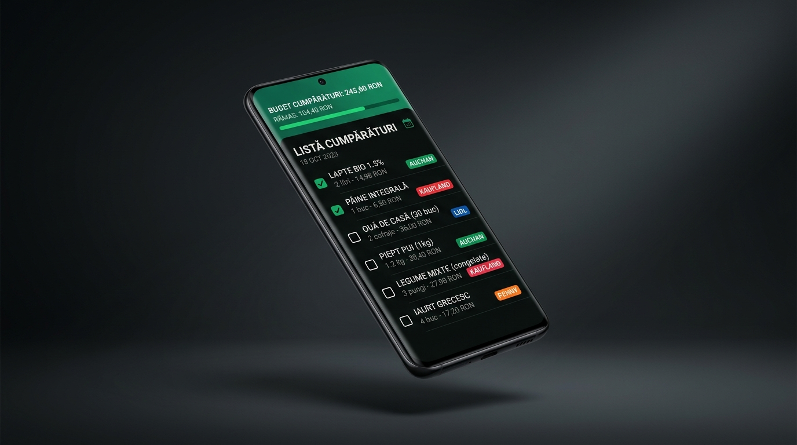
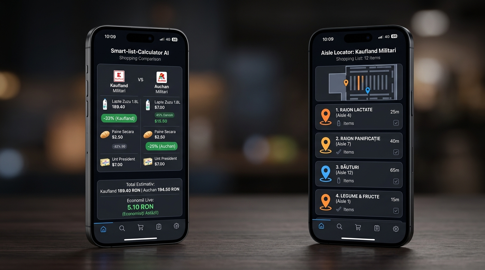
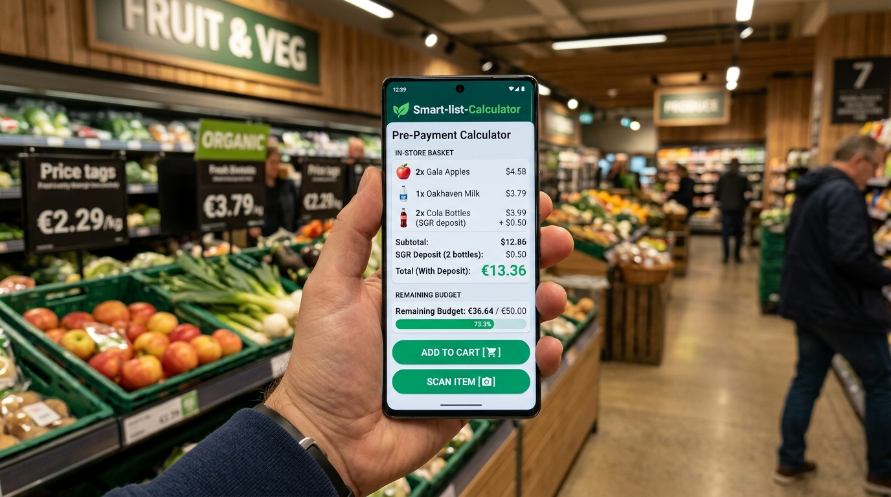
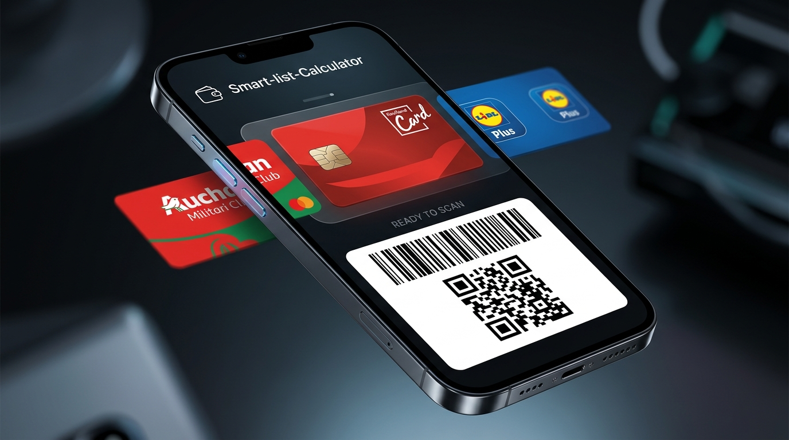

# 🛒 Smart-list-Calculator (Android 2026)
### *Aplicație Mobilă Inteligentă de Cumpărături, Calculator Pre-Plată la Raft & Monitorizare Reduceri Magazine Militari București*

[-green.svg?style=for-the-badge&logo=android)](https://www.android.com/)
[](https://kotlinlang.org/)
[](https://developer.android.com/jetpack/compose)
[]()
[-red.svg?style=for-the-badge&logo=sqlite)](https://developer.android.com/training/data-storage/room)
[](Smart-list-Calculator-Release-2026.apk)

---

## 📱 Prezentare Generală & Identitate Vizuală

**Smart-list-Calculator** este o aplicație modernă, performantă și complet independentă, concepută pentru a transforma cumpărăturile din supermarket într-o experiență calculată, rapidă și economică. 

Aplicația combină un **calculator de buget la raft în timp real** cu un **Agent Inteligent dedicat marilor magazine din zona Militari, București** (*Kaufland Valea Cascadelor* și *Auchan Militari*), salvare automată a bazei de date **100% offline** și export dedicat în **fișiere `.txt` structurate direct în memoria telefonului tău**.

<div align="center">
  
  <br/>
  <em>Iconiță Ultra-Modernă 3D Glassmorphic • Smart-list-Calculator</em>
</div>

---

## 📸 Mockup-uri & Prezentare Ecrane

Aplicația a fost proiectată conform celor mai stricte standarde Material Design 3, oferind temă întunecată cu accente neon vibrante, contrast ridicat pentru lizibilitate optimă sub luminile puternice din supermarket și micro-animații fluide la 120Hz.

### 1. Prezentare Generală Liste & Monitorizare Buget
Gestionare dinamică a listelor, stadiu de bifare cu procente, urmărire vizuală a bugetului și acces rapid la funcții cheie.

<div align="center">
  
</div>

---

### 2. Agent Inteligent & Monitorizare Reduceri (Kaufland & Auchan Militari)
Comparație instantă între coșul de la **Kaufland Militari** și **Auchan Militari**, economie netă calculată în RON, navigator la raft (număr raion) și alerte automate de promoții în bara de notificări.

<div align="center">
  
</div>

---

### 3. Calculator Pre-Plată la Raft & Comparație Preț Unitar
Calculează suma exactă înainte de casa de marcat, adaugă automat garanția **SGR (0.50 RON)** pe ambalaj, compară prețul pe kilogram / litru și semnalizează prin cod de culoare atingerea pragului de cheltuieli.

<div align="center">
  
</div>

---

### 4. Portofel Securizat Carduri Magazin & Scanare Instantanee POS
Gestionează toate cardurile de fidelitate (Kaufland, Auchan, Lidl, Carrefour etc.) într-un portofel digital 3D securizat offline. Scanează cardul fizic direct cu camera telefonului și afișează codul de bare mărit și luminos la casa de marcat.

<div align="center">
  
</div>

---

## 🌟 Funcționalități Majore

### 🤖 1. Agent Inteligent & Monitorizare Reduceri Magazine Militari
Aplicația integrează un modul nativ cu date sincronizate pentru principalele hipermarketuri din cartierul Militari, București:
* **Kaufland Militari** — *Strada Valea Cascadelor nr. 3, Sector 6*
* **Auchan Militari** — *Centrul Comercial Militari, Bulevardul Iuliu Maniu nr. 560A*

#### Capabilități Agent:
* **Comparație Coș**: Evaluează automat produsele din lista ta și îți arată care magazin are cel mai mic total și câți RON economisești.
* **Găsește pe Raft (In-Store Aisle Navigator)**: Îți indică raionul exact unde se află fiecare produs (ex: *Raionul 4 - Lactate*, *Raionul 7 - Băuturi*, *Raionul 1 - Panificație*).
* **Catalog Reduceri Active**: Reduceri de până la 35% actualizate pe categorii esențiale (ulei, cafea, lactate, detergenți etc.).
* **Alerte Automate în Bara de Notificări**: Sistem de notificări Android cu sunet și vibrație pentru reduceri fulger la magazinele din Militari.

---

### 💾 2. Salvare Locală pe Telefon & Export în Fisiere `.txt`
Intimitatea și siguranța datelor tale sunt prioritare:
* **Bază de date 100% Locală (Room SQLite)**: Niciun cont obligatoriu pe cloud, toate listele, istoricul de prețuri și produsele rămân stocate intern pe telefon.
* **Folder Dedicat pe Dispozitiv**: Aplicația creează și întreține automat folderul dedicat:
  ```text
  📁 Stocare Internă / Documents / SmartListCalculator /
  ```
* **Fișiere `.txt` Detaliate Generate**:
  Fiecare listă poate fi salvată cu 1 tap sub forma unui fișier text structurat și ușor de citit pe orice dispozitiv sau de trimis prin Bluetooth/USB:
  * `Lista_Cumparaturi_Familie_2026-10-15_22-00.txt`
  * `Index_Toate_Listele_SmartListCalculator.txt`

#### Exemplu format fișier `.txt` salvat:
```text
=================================================================
         SMART-LIST-CALCULATOR • RAPORT DETALIAT LISTĂ           
=================================================================

📋 NUME LISTĂ: Cumpărături Săptămână
📅 DATA SALVĂRII: 15 octombrie 2026, 22:15
🏪 MAGAZIN ASOCIAT: Kaufland Militari
📍 ADRESĂ MAGAZIN: Str. Valea Cascadelor nr. 3, Sector 6
💰 BUGET LIMITĂ: 250.00 RON
📊 TOTAL ESTIMAT: 198.40 RON
💳 TOTAL CHELTUIT EFECTIV: 184.20 RON
🎯 PROGRES: 8/8 produse (100%)

-----------------------------------------------------------------
                       PRODUSE ȘI DETALII                        
-----------------------------------------------------------------
01. [CUMPĂRAT] Lapte Zuzu 1.5% 1L
    Cantitate: 2.0 buc (2 ambalaje/buc) • Preț unitar: 6.89 RON • Total: 13.78 RON
    Categorie: Lactate
    Magazin/Raion: Raionul 4 - Frigidere Lactate

02. [CUMPĂRAT] Apă Minerală Borsec 2L
    Cantitate: 6.0 buc (6 ambalaje/buc) • Preț unitar: 3.49 RON • Total: 20.94 RON
    Categorie: Băuturi
    Magazin/Raion: Raionul 7 - Ape și Sucuri
    Note: Include garanție SGR 0.50 RON/sticlă
=================================================================
Folder dedicat telefon: /storage/emulated/0/Documents/SmartListCalculator/
Generat automat de aplicația Smart-list-Calculator (Android 2026)
=================================================================
```

### 💳 3. Portofel Securizat Carduri Magazin (Loyalty Wallet) & Scanare Nativă
Spune adio teancului de carduri de plastic din portofel la cumpărături:
* **Securitate & Stocare 100% Locală**: Cardurile tale de fidelitate sunt stocate securizat direct pe telefon în baza de date Room SQLite (zero acces terț, confidențialitate absolută).
* **Scanare Carduri Fizice cu Camera**: Deschizi scanerul integrat bazat pe CameraX & ZXing, încadrezi codul de bare sau codul QR de pe cardul de plastic, iar aplicația îl recunoaște instantaneu.
* **Prescurtări Rapide pentru Magazine Românești**: Presets pre-colorate pentru *Kaufland Card (Militari)*, *MyClub Auchan (Militari)*, *Lidl Plus*, *Carrefour Act For Good*, *Mega Image*, *Penny*, *Catena*, *Dr. Max* sau magazine custom.
* **Mod Optimizat pentru Scanerul de la Casă (Cashier POS Mode)**: La un singur tap pe card, ecranul afișează codul de bare mărit cu contrast maxim alb-negru (Code 128 / QR Code) pentru scanare din prima secundă la casele asistate sau la casele de tip self-checkout.
* **Acces Imediat din Modul Cumpărături**: Când ești la casierie în aplicație, ai butonul `[💳 Card Magazin]` chiar în bara superioară, fără a fi nevoie să cauți prin alte meniuri.

---

### 🧮 4. Calculator Pre-Plată & Detector Garanție SGR
* **Estimare Real-Time**: Pe măsură ce adaugi produse în coș la cumpărături, totalul se recalculează instant.
* **Garanție SGR (0.50 RON)**: Recunoaște automat ambalajele de sticlă, plastic și doze de aluminiu supuse Sistemului de Garanție-Returnare din România și adaugă 0.50 RON/bucată în defalcarea financiară.
* **Comparație Preț pe Unitate**: Vezi instant dacă un pachet mare de 800g este mai avantajos decât 2 pachete de 350g (calcul automat RON/kg).
* **Indicator Vizual Buget**:
  * 🟢 **Verde**: Consum sub 80% din bugetul alocat.
  * 🟡 **Galben/Portocaliu**: Între 80% și 100% din buget (Avertizare prag).
  * 🔴 **Roșu**: Depășire de buget cu alertă haptică.

---

### 🚀 4. Alte Funcționalități Integrate
* **Flux de Cumpărături în 3 Stadii**: `De Căutat` ➔ `În Coș` ➔ `Achiziționat / Plătit`.
* **Partajare Instant WhatsApp**: Trimite lista aranjată cu bifă către partenerul de viață sau colegi direct pe WhatsApp.
* **Sincronizare Google Opțională**: Pentru utilizatorii care doresc și backup securizat în contul propriu Google Firebase.

---

### 🧠 5. AI Smart Multi-Store Import & Corector Automat de Spații (Noutate 2026)
Aplicația include un parser lingvistic avansat adaptat limbii române, capabil să citească liste brute din WhatsApp, Notițe, SMS sau clipboard și să le organizeze inteligent:
* **Fără Liste Predefinite**: Aplicația pornește curată, oferind libertate completă utilizatorului.
* **Segmentare Automată pe Magazine**: Recunoaște antetele de magazine (`Piață :`, `Metro:`, `Auchan :`, `Kaufland:`, `Lidl:`, `Carrefour:` etc.) și asociază instant fiecare articol magazinului corespunzător.
* **Identificare și Corectare Automată a Spațiilor Lipsă**:
  * Cifre lipite de unități de măsură: `2kg` ➔ `2 kg`, `3kg` ➔ `3 kg`, `500g` ➔ `500 g`.
  * Liniuțe de despărțire fără spații: `săsesc- 1` ➔ `săsesc - 1`, `Lapte-2` ➔ `Lapte - 2`.
* **Extragere Note & Ambalaje Speciale**: Extrage automat detaliile dintre paranteze (ex: `( galetusa )` ➔ Notă: *Găletușă*, `( profi )` ➔ Notă: *profi*, `Cofrag - 30 oua` ➔ *Cofraj 30 buc*).
* **Dicționar Românesc Extins de Supermarket**: Normalizare diacritice și clasificări automate pe categorii (*Lactate*, *Carne & Mezeluri*, *Fructe & Legume*, *Alimente de bază*, *Curățenie*).
* **Flexibilitate la Import (1-Tap)**:
  * 🏬 **Opțiunea 1**: *Creează liste separate pe magazine* (creează 4 liste distincte: Piață, Metro, Auchan, Kaufland).
  * 🛒 **Opțiunea 2**: *Creează 1 singură listă unificată grupată* (toate articolele într-o listă, etichetate cu magazinul lor).

#### Exemplu Real Testat & Suportat:
```text
Lista cumpărături 

Piață : 
1. Cartofi 10 kg
2. Fasole 2kg
3. Branza capra 

Metro:
1. Săpun - 6 buc
2. Bulion sultan - 4 buc
3. Samntana ( galetusa ) - 1 buc 
4. Salam săsesc- 1 buc 
5. Orez - 1 buc  
6. Scărița afumata 3kg 

Auchan : 
1. Cofrag - 30 oua 

Kaufland:
1. File de pui cu susan - 6 
2. Lapte dulce - 2 
3. Cascaval 
4. Iaurt cremosso - 4 buc ( profi )
```

---

## 📦 Instalare Rapidă pe Dispozitiv Android

Pachetul de instalare final optimizat și semnat este gata în rădăcina proiectului:
📂 **`Smart-list-Calculator-Release-2026.apk`** *(3.76 MB)*

### Opțiunea 1: Instalare Directă din Telefon (Recomandat)
1. Descarcă fișierul `Smart-list-Calculator-Release-2026.apk` pe telefonul tău Android.
2. Deschide fișierul descărcat din aplicația de gestionare a fișierelor (Files / Descărcări).
3. Dacă este solicitat, activează permisiunea **„Permite instalarea din această sursă”**.
4. Apasă **Instalați** și deschide aplicația!

### Opțiunea 2: Instalare prin Cablu USB (ADB)
Dacă ai telefonul conectat la computer cu modul *USB Debugging* activat:
```bash
adb install Smart-list-Calculator-Release-2026.apk
```

---

## 🛠️ Arhitectură & Tehnologii

Proiectul este dezvoltat conform principiilor **Clean Architecture**, decuplat pe straturi cu dependențe unidirecționale:

```text
ro.smartshopping.list/
├── data/
│   ├── local/
│   │   ├── dao/                     # Room Data Access Objects
│   │   ├── database/                # Room SQLite Database Instance & Migrations
│   │   ├── entity/                  # Entități SQLite
│   │   └── LocalBackupStorageManager.kt # Gestionare folder dedicat & export .TXT
│   └── repository/
│       ├── ShoppingListRepositoryImpl.kt
│       └── StoreDealsRepository.kt  # Sursă date Kaufland & Auchan Militari
├── domain/
│   ├── model/                       # Modele imutabile (ShoppingList, StoreDeal, etc.)
│   └── usecase/
│       ├── SmartDiscountAgentUseCase.kt  # Algoritm comparație coș & economii
│       ├── PrePaymentCalculatorUseCase.kt # Calcule preț unitar & SGR
│       └── CalculateFinancialSummaryUseCase.kt
├── ui/
│   ├── components/                  # Componente UI refolosibile Material 3
│   ├── navigation/                  # AppNavHost, BottomNavBar, Rute
│   ├── screens/
│   │   ├── lists/                   # Ecran Liste Principale
│   │   ├── detail/                  # Ecran Detaliu Listă & Buton Export TXT
│   │   ├── shopping/                # Mod Cumpărături la Raft & Pre-Payment
│   │   └── agent/                   # Ecran Agent Inteligent Magazine Militari
│   └── theme/                       # Paletă cromatică Neon Glass, Tipografie, Shape
└── util/
    └── StoreNotificationHelper.kt   # Notificări locale Android NotificationCompat
```

---

## 🧪 Rulare Teste & Compilare din Cod Sursă

Aplicația beneficiază de o suită completă de 28 de teste unitare automate (100% passing):

```bash
# Rulare toate testele unitare
./gradlew test

# Rulare build complet în mod Release
./gradlew assembleRelease
```

---

## 📄 Licență & Credite
Dezvoltat cu pasiune pentru cumpărături inteligente în România de echipa **Nazjar Graphic Creator UX**.  
Toate drepturile rezervate © 2026.
